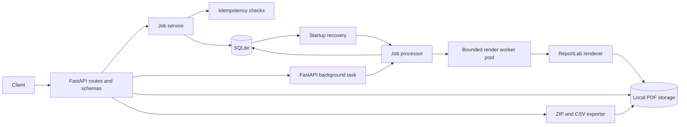

# CertFlow — Bulk Certificate Generation API

Bulk Certificate Generator API is a FastAPI service that accepts one job containing multiple recipients, generates an individual PDF certificate for every valid recipient, records recipient-level outcomes, and exposes job progress and certificate downloads.

The design favors a self-contained local setup: SQLite stores job metadata and ReportLab writes PDFs to local file storage. Invalid recipients and rendering failures are isolated so they do not prevent other certificates in the same job from completing. Idempotent submission, startup recovery, integrity metadata, and bulk export cover common operational failure modes without introducing external infrastructure.

## Features

- Bulk job creation with HTTP 202 responses
- Idempotent retries through the `Idempotency-Key` header
- Request-level and recipient-level validation
- A predefined, landscape PDF certificate template
- Persistent job status, counters, timestamps, and recipient outcomes
- `PENDING`, `PROCESSING`, `COMPLETED`, `PARTIALLY_COMPLETED`, and `FAILED` job states
- Startup recovery for jobs interrupted by a process restart
- SHA-256 integrity metadata and on-demand certificate verification
- ZIP export containing successful PDFs and a full CSV outcome report
- Structured JSON logs with job IDs, counts, durations, and failure context
- Job-scoped certificate downloads with cross-job access protection
- UUID-based filenames and storage path confinement
- Consistent safe JSON errors without stack-trace disclosure
- Alembic migrations, Docker configuration, automated tests, Ruff, and GitHub Actions CI

## Technology stack

- Python 3.11+
- FastAPI and Pydantic v2
- SQLAlchemy 2.x and SQLite
- Alembic
- ReportLab
- pytest, FastAPI TestClient, httpx, and pypdf
- Ruff
- Docker and Docker Compose

## Architecture



HTTP routes validate and translate requests but do not contain certificate-generation logic. `JobService` owns job persistence and idempotency, `JobProcessor` coordinates recovery, an application-wide bounded render pool, and batched status updates, `CertificateRenderer` owns the single PDF design, and `CertificateStorage` confines all artifact paths beneath the configured storage root. Only each job coordinator writes its results, avoiding concurrent SQLite writers within a job while the global pool prevents thread growth as jobs arrive.

## Project structure

```text
.
|-- app/
|   |-- api/                 # Routes and FastAPI dependencies
|   |-- core/                # Configuration and logging
|   |-- db/                  # SQLAlchemy base, models, and sessions
|   |-- schemas/             # Pydantic request and response models
|   |-- services/            # Validation, processing, rendering, and storage
|   `-- main.py              # Application factory and exception handlers
|-- migrations/              # Alembic environment and schema revisions
|-- sample_requests/         # Copy-ready API payloads
|-- scripts/                 # Reproducible real-system benchmark
|-- tests/                   # Isolated API and service integration tests
|-- .env.example
|-- compose.yaml
|-- Dockerfile
|-- pyproject.toml
`-- REQUIREMENTS_CHECKLIST.md
```

## Data model

`certificate_jobs` stores certificate-wide data, lifecycle status, counters, timestamps, a hashed idempotency key, and a canonical request hash. The unique key hash prevents duplicate job creation. `certificate_records` stores one row per submitted recipient, including its stable input order, validation or generation outcome, safe error message, relative PDF path, and SHA-256 digest. A foreign key with cascade deletion associates records with their job, and a unique constraint prevents duplicate recipient positions within one job.

PDF data is not stored in SQLite. Files use generated job and certificate UUIDs, so duplicate or filename-like recipient names cannot collide or control filesystem paths.

## API endpoints

| Method | Path | Purpose | Success |
|---|---|---|---|
| `GET` | `/health` | Liveness check | `200` |
| `POST` | `/api/v1/jobs` | Create a bulk certificate job | `202` |
| `GET` | `/api/v1/jobs/{job_id}` | Read progress and paginated recipient outcomes | `200` |
| `GET` | `/api/v1/jobs/{job_id}/archive` | Download successful PDFs and a CSV report as ZIP | `200` |
| `GET` | `/api/v1/jobs/{job_id}/certificates/{certificate_id}` | Download a completed PDF | `200` |
| `GET` | `/api/v1/jobs/{job_id}/certificates/{certificate_id}/verify` | Compare a PDF with its recorded SHA-256 digest | `200` |

Interactive OpenAPI documentation is available at `http://localhost:8000/docs` while the application is running.

## Local development

### Prerequisites

- Python 3.11 or newer
- Git
- Docker Desktop or another Docker-compatible runtime only for the container workflow

### Install

On macOS or Linux:

```bash
python3 -m venv .venv
source .venv/bin/activate
python -m pip install --upgrade pip
pip install -e ".[dev]"
```

On Windows PowerShell:

```powershell
py -3.11 -m venv .venv
.\.venv\Scripts\Activate.ps1
python -m pip install --upgrade pip
pip install -e ".[dev]"
```

No environment variables are required for local development. Copy `.env.example` to `.env` only when overriding defaults:

```bash
cp .env.example .env
```

PowerShell equivalent:

```powershell
Copy-Item .env.example .env
```

| Variable | Required | Default | Description |
|---|---|---|---|
| `APP_ENV` | No | `development` | Runtime environment label |
| `DATABASE_URL` | No | `sqlite:///./data/certificates.db` | SQLAlchemy database URL |
| `STORAGE_DIR` | No | `./data/certificates` | Root directory for generated PDFs |
| `MAX_RECIPIENTS` | No | `500` | Maximum recipients accepted in one job |
| `RENDER_WORKERS` | No | `4` | Maximum PDFs rendered concurrently across the application |
| `PROCESSING_BATCH_SIZE` | No | `100` | Outcomes persisted in each database transaction |
| `LOG_LEVEL` | No | `INFO` | Python logging level |
| `LOG_FORMAT` | No | `json` | `json` for structured logs or `text` for local readability |

Apply the database migration:

```bash
alembic upgrade head
```

Start one application worker:

```bash
uvicorn app.main:app --reload
```

For a production-style local command, omit `--reload`:

```bash
uvicorn app.main:app --host 0.0.0.0 --port 8000
```

## Complete API workflow

Create a job with the included sample request:

```bash
curl -i -X POST http://localhost:8000/api/v1/jobs \
  -H "Content-Type: application/json" \
  -H "Idempotency-Key: enrollment-import-2026-10-08" \
  --data @sample_requests/create_job.json
```

Example response:

```json
{
  "job_id": "03bd7f9c-0c5d-42e3-8f34-6d86256c4693",
  "status": "PENDING",
  "total_recipients": 2,
  "status_url": "/api/v1/jobs/03bd7f9c-0c5d-42e3-8f34-6d86256c4693",
  "idempotency_replayed": false
}
```

Repeating the same payload with the same key returns the original job and sets `idempotency_replayed` and the `Idempotency-Replayed` response header to `true`. Reusing a key with a different payload returns HTTP 409. Keys are stored only as SHA-256 hashes.

Poll job status using the returned URL:

```bash
curl http://localhost:8000/api/v1/jobs/03bd7f9c-0c5d-42e3-8f34-6d86256c4693
```

For frequent progress polling, omit recipient outcomes to keep the response small:

```bash
curl "http://localhost:8000/api/v1/jobs/03bd7f9c-0c5d-42e3-8f34-6d86256c4693?include_recipients=false"
```

Recipient outcomes are ordered by their original input position and paginated with `recipient_offset` and `recipient_limit`. The default page contains 100 outcomes and the maximum page size is 500:

```bash
curl "http://localhost:8000/api/v1/jobs/03bd7f9c-0c5d-42e3-8f34-6d86256c4693?recipient_offset=100&recipient_limit=100"
```

A completed recipient includes its certificate ID and download URL:

```json
{
  "job_id": "03bd7f9c-0c5d-42e3-8f34-6d86256c4693",
  "status": "COMPLETED",
  "certificate_title": "Advanced Backend Engineering",
  "issuing_organization": "AEREO Learning",
  "issue_date": "2026-10-08",
  "total_recipients": 2,
  "successful_generations": 2,
  "failed_generations": 0,
  "pending_generations": 0,
  "progress_percentage": 100.0,
  "created_at": "2026-10-08T13:30:00Z",
  "started_at": "2026-10-08T13:30:00Z",
  "completed_at": "2026-10-08T13:30:01Z",
  "recipients": [
    {
      "certificate_id": "86f8f39b-a37a-4411-90df-cc59cd201b66",
      "recipient_index": 0,
      "recipient_name": "Aarav Sharma",
      "recipient_email": "aarav.sharma@example.com",
      "status": "COMPLETED",
      "error_message": null,
      "download_url": "/api/v1/jobs/03bd7f9c-0c5d-42e3-8f34-6d86256c4693/certificates/86f8f39b-a37a-4411-90df-cc59cd201b66",
      "sha256": "fd9d4d93115213acb37b9cc497afc1efb2d95a7793b09b92310a9b39d254fc9a"
    }
  ],
  "recipient_page": {
    "offset": 0,
    "limit": 100,
    "returned": 2,
    "total": 2
  }
}
```

Download a certificate:

```bash
curl -o certificate.pdf \
  http://localhost:8000/api/v1/jobs/03bd7f9c-0c5d-42e3-8f34-6d86256c4693/certificates/86f8f39b-a37a-4411-90df-cc59cd201b66
```

Verify stored file integrity or download the complete job archive:

```bash
curl http://localhost:8000/api/v1/jobs/03bd7f9c-0c5d-42e3-8f34-6d86256c4693/certificates/86f8f39b-a37a-4411-90df-cc59cd201b66/verify

curl -o certificates.zip \
  http://localhost:8000/api/v1/jobs/03bd7f9c-0c5d-42e3-8f34-6d86256c4693/archive
```

The archive contains every successful PDF under `certificates/` and `report.csv` with all successful and failed recipients, error messages, checksums, and download URLs.

The identifiers above are illustrative. Use the values returned by the running API.

## Validation and partial failures

The request envelope must contain a valid certificate definition and a non-empty recipient list within `MAX_RECIPIENTS`. Unknown fields, invalid dates, malformed recipient collections, and missing certificate-wide fields return HTTP 422 without creating a job.

Recipient objects are evaluated independently. A missing, non-string, blank, control-character-containing, or over-200-character name fails that recipient. An optional email must be a plausible address no longer than 320 characters. Invalid recipients are visible in job status with a safe failure message, while valid recipients continue processing. A job is `PARTIALLY_COMPLETED` when at least one certificate succeeds and at least one fails.

## Error responses

Errors use a consistent envelope:

```json
{
  "error": {
    "code": "certificate_not_found",
    "message": "The requested certificate does not belong to this job."
  }
}
```

The download endpoint returns `404` for unknown or cross-job identifiers, `409` when generation failed, remains incomplete, or fails its checksum, and `410` when the database references a completed artifact that is missing from storage. Archive generation returns `409` until processing is terminal and `410` if a required successful artifact is missing.

## Tests and linting

```bash
ruff check .
pytest -q
```

To include coverage:

```bash
pytest --cov=app --cov-report=term-missing
```

Tests create an isolated temporary SQLite database and storage directory for each test. The 42-test suite exercises real HTTP endpoints, SQLAlchemy persistence, actual ReportLab output, PDF text extraction, idempotency, recovery, integrity tampering, and ZIP contents. A reliability test submits 100 recipients, injects one render failure, verifies 99 successes and one failure at 100% progress, and downloads all 99 successful PDFs.

Recovery was also exercised against the Docker service by force-stopping it during a 5,000-recipient job. The persisted state showed 1,100 completed and 3,900 pending recipients at shutdown; startup reconciliation resumed the same job and finished with 5,000 successes, zero failures, and no pending records.

## Reproducible benchmark

The processor fetches pending recipients in bounded batches, renders each batch through one application-wide configurable thread pool, and writes all outcomes from that batch in one database transaction. Job creation also inserts recipient rows in bulk. SQLite uses WAL mode, normal synchronization, and a busy timeout to allow progress reads while generation is active.

A benchmark script drives the running HTTP API and uses the real database, renderer, checksum calculation, and file storage:

```bash
python scripts/benchmark.py --sizes 10 100 1000
```

Set `MAX_RECIPIENTS` at least as high as the largest case before starting the service. The script uses a unique idempotency key per run and prints a Markdown table. Use `--json` for machine-readable output.

Measured on Docker Desktop on the development machine with four render workers and a batch size of 100:

| Recipients | Request acceptance | Completion | Successful | Failed | Throughput |
|---:|---:|---:|---:|---:|---:|
| 10 | 0.073 s | 0.230 s | 10 | 0 | 43.56 PDFs/s |
| 100 | 0.079 s | 0.608 s | 100 | 0 | 164.53 PDFs/s |
| 1,000 | 0.126 s | 5.204 s | 1,000 | 0 | 192.16 PDFs/s |
| 5,000 | 0.334 s | 21.778 s | 5,000 | 0 | 229.59 PDFs/s |

These are local measurements, not throughput guarantees. Results depend on CPU allocation, storage performance, template complexity, recipient data, and other host activity. The 5,000-recipient run was performed after integrity hashing was enabled.

## Docker

Build and start the API:

```bash
docker compose up --build
```

The container applies migrations before starting Uvicorn, runs as a non-root user, and persists the SQLite database and generated PDFs in the `certificate_data` volume.

Compose forwards the processing settings from `.env`. For a deliberate 5,000-recipient local test, use values such as:

```dotenv
MAX_RECIPIENTS=5000
RENDER_WORKERS=4
PROCESSING_BATCH_SIZE=100
```

Increase `RENDER_WORKERS` only after measuring the host. More threads can reduce performance when CPU or storage is already saturated.

Stop the service:

```bash
docker compose down
```

Add `-v` only when intentionally deleting the persistent Docker volume and all generated data.

## Design decisions and trade-offs

- **Idempotent submission:** A unique hash of the optional client key maps retries to one job. A canonical request hash detects accidental key reuse with different content. Keys currently have no expiration policy.
- **In-process background execution with recovery:** FastAPI background tasks keep the create request responsive without adding Redis or a worker service. On startup, persisted `PENDING` and `PROCESSING` jobs are reconciled and remaining recipient records are processed. An atomic status claim prevents two in-process coordinators from starting the same pending job.
- **Bounded parallel rendering:** Independent PDFs are rendered concurrently, while a single coordinator persists results. Each future captures its own failure, so one broken recipient does not cancel the batch.
- **Batched commits:** Outcomes are committed once per configurable batch instead of once per certificate. A crash can leave rendered files whose pending records were not committed; recovery safely overwrites their deterministic identifier-based paths.
- **SQLite and local storage:** They make evaluation simple and credential-free. WAL mode improves concurrent status reads, but SQLite still serializes writes and local files are not shared across hosts, so this deployment is intended for one application instance.
- **Paginated status:** Lightweight summary polling avoids loading or serializing thousands of recipient records. Outcome pages remain available when detailed inspection is needed.
- **Relative paths instead of PDF blobs:** The database remains small and queryable while the storage layer enforces a single trusted root.
- **Integrity rather than authenticity:** SHA-256 detects modification or corruption relative to the database record. It is not a digital signature and does not prove who issued a certificate.
- **Transient archive generation:** ZIP output uses a spooled temporary file and is not retained after the response. This avoids persistent duplicate artifacts but still consumes local disk space for large archives.
- **Derived progress:** Pending count and percentage derive from persisted totals, successes, and failures, reducing the number of independently mutable counters.

## Known limitations

- Recovery begins on restart, but the in-process queue does not provide delivery guarantees while the service is stopped. There is no independent worker or retry scheduler.
- The local SQLite and filesystem design is intentionally single-instance and is not suitable for horizontal scaling or multiple Uvicorn workers.
- Jobs that repeatedly fail due to a systemic renderer or storage problem require operator intervention; there is no configurable retry or dead-letter policy.
- There is no authentication or authorization; deploy behind an appropriate access-control layer when certificates contain private data.
- Generated files have no automatic retention or cleanup policy.
- The predefined template uses ReportLab core fonts. Complex writing systems require a licensed Unicode font to be bundled and registered.
- ZIP archives are created on demand rather than cached, so repeated large downloads repeat compression work.
- Idempotency records do not expire automatically.

## Future improvements

- Move execution to a durable queue with leases, retry backoff, and dead-letter handling when multi-instance operation is needed.
- Move artifacts to object storage and use short-lived signed download URLs.
- Add authentication, ownership checks, and audit events.
- Add retention policies, job cancellation, explicit retries, idempotency-key expiration, and webhooks.
- Bundle a broad Unicode font and add multilingual rendering tests.
- Export metrics and traces for queue latency, per-batch render duration, recovery, and failure rates.

## Implementation insights

The central reliability concern is not rendering a PDF; it is preserving accurate job state when requests are retried or processing stops midway through a batch. Separating request-level validation from recipient-level outcomes makes partial success explicit. Idempotent creation, persisted per-recipient state, startup reconciliation, bounded rendering concurrency, and a single database writer keep the behavior understandable and testable. Identifier-based storage also removes recipient input from the filesystem trust boundary.
