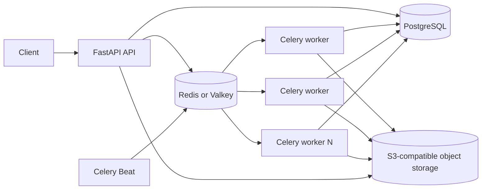

# CertFlow — Bulk Certificate Generation API

CertFlow is a FastAPI service for bulk PDF certificate generation with persistent job tracking, recipient-level failure isolation, idempotent submissions, integrity checks, and ZIP/CSV exports. It offers a self-contained SQLite profile for evaluation and a distributed profile using PostgreSQL, Celery, Redis, and S3-compatible object storage.

## Features

- JSON bulk submission and memory-bounded CSV import
- Built-in responsive operations console with no separate frontend deployment
- HTTP 202 job creation with polling and paginated outcomes
- Recipient-level validation and render-failure isolation
- Professional ReportLab PDF template with long-name handling
- Idempotent retries through the `Idempotency-Key` header
- Persistent progress counters and terminal job states
- SHA-256 integrity metadata and verification endpoint
- Asynchronous ZIP export with a complete CSV outcome report
- Lease-based distributed work claiming and interrupted-work recovery
- Structured logs containing job IDs, durations, counts, and errors
- Alembic migrations, pytest coverage, Ruff, Docker, and CI

## Deployment profiles

### Local profile

The default profile uses SQLite, local files, FastAPI background tasks, and a bounded render pool. It has no external service dependencies and is the fastest way to evaluate the API. It is deliberately single-instance because SQLite serializes writes and local files are not shared between hosts.

### Distributed profile

The optional distributed profile uses:

- PostgreSQL for shared job and recipient state
- a Redis-compatible Celery broker: Redis locally or Valkey on AWS
- Multiple Celery workers for PDF rendering
- S3-compatible storage for PDFs and archives
- Celery Beat for expired-lease recovery

Workers claim small recipient batches with row locks and `SKIP LOCKED`. Each claim has a token and expiration time. A stale worker cannot overwrite a later successful attempt because its database update must still own the matching token. Attempt-specific object keys also prevent concurrent attempts from overwriting each other's artifacts.

This architecture removes the fixed capacity of a single application process, but it does not imply infinite capacity. Maximum practical volume depends on PostgreSQL sizing, broker throughput, object storage, worker count, disk and network bandwidth, retention policy, and operational limits. Large submissions should use CSV import; the JSON endpoint intentionally retains a configurable request-size guard.

## Architecture



The API validates and persists work before dispatch. `JobService` owns creation and idempotency; `DistributedJobProcessor` owns claims, rendering, and outcome persistence; `ArchiveProcessor` builds recoverable exports; `CertificateRenderer` owns the PDF design; and the storage abstraction supports either a confined local directory or S3-compatible storage.

## Project structure

```text
.
|-- app/
|   |-- api/                 # HTTP routes and dependencies
|   |-- core/                # Settings and logging
|   |-- db/                  # SQLAlchemy models and sessions
|   |-- schemas/             # Pydantic request and response models
|   |-- services/            # Jobs, rendering, storage, archives, dispatch
|   |-- web/                 # HTML, CSS, and JavaScript operations console
|   |-- celery_app.py        # Celery configuration and recovery schedule
|   |-- tasks.py             # Distributed worker entry points
|   `-- main.py              # FastAPI application factory
|-- migrations/              # Alembic revisions
|-- infra/                   # AWS CDK production infrastructure
|-- sample_requests/         # JSON and CSV examples
|-- scripts/benchmark.py     # Real HTTP/database/render benchmark
|-- tests/                   # Unit and integration tests
|-- cdk.json                 # CDK application configuration
|-- compose.yaml             # Self-contained local profile
|-- compose.distributed.yaml # Distributed local stack
|-- Dockerfile
|-- pyproject.toml
`-- REQUIREMENTS_CHECKLIST.md
```

## Data model

`certificate_jobs` stores certificate-wide fields, lifecycle state, counters, timestamps, idempotency hashes, dispatch timestamps, and archive state. `certificate_records` stores one row per recipient with its stable input order, validation or rendering outcome, object key, SHA-256 digest, claim token, lease expiration, and attempt count.

Constraints prevent negative or inconsistent counters, a unique index protects idempotency keys, and a unique `(job_id, recipient_index)` constraint preserves input identity. PDF bytes remain in file or object storage instead of the relational database.

## API

| Method | Path | Purpose |
|---|---|---|
| `GET` | `/health` | Liveness check |
| `POST` | `/api/v1/jobs` | Submit a JSON job |
| `POST` | `/api/v1/jobs/import` | Stream a CSV job upload |
| `GET` | `/api/v1/jobs/{job_id}` | Read progress and paginated outcomes |
| `POST` | `/api/v1/jobs/{job_id}/archive` | Request ZIP generation |
| `GET` | `/api/v1/jobs/{job_id}/archive` | Download a completed ZIP |
| `GET` | `/api/v1/jobs/{job_id}/certificates/{certificate_id}` | Download a PDF |
| `GET` | `/api/v1/jobs/{job_id}/certificates/{certificate_id}/verify` | Verify the stored checksum |

Interactive OpenAPI documentation is available at `http://localhost:8000/docs`.

## Web interface

Open `http://localhost:8000/` after starting either deployment profile. The responsive operations console uses the same origin as the API and therefore requires no CORS configuration or separate Node service. It supports recipient-list and CSV submissions, optional idempotency keys, automatic status polling, progress and failure inspection, paginated outcomes, individual PDF downloads, and asynchronous ZIP requests.

The interface is implemented with semantic HTML, CSS, and browser JavaScript. User-provided values are inserted with DOM text nodes rather than HTML interpolation. The API remains the source of truth, so every operation available through the interface can also be scripted through the documented endpoints.

## Local development

### Prerequisites

- Python 3.11 or newer
- Git
- Docker Desktop only for container workflows
- Node.js 20 or newer only for AWS CDK workflows

### Installation

Windows PowerShell:

```powershell
py -3.11 -m venv .venv
Set-ExecutionPolicy -Scope Process -ExecutionPolicy RemoteSigned
.\.venv\Scripts\Activate.ps1
python -m pip install --upgrade pip
pip install -e ".[dev]"
alembic upgrade head
uvicorn app.main:app --reload
```

macOS or Linux:

```bash
python3 -m venv .venv
source .venv/bin/activate
python -m pip install --upgrade pip
pip install -e ".[dev]"
alembic upgrade head
uvicorn app.main:app --reload
```

No environment variables are required for this profile. Copy `.env.example` to `.env` only to override defaults.

### Local Docker profile

```bash
docker compose up --build
```

The API is exposed on port 8000. SQLite and generated files persist in the `certificate_data` volume.

## Distributed local stack

The distributed Compose file requires locally chosen PostgreSQL and object-storage credentials. Do not commit the resulting file. The local stack uses RustFS through the standard S3 API; production can use AWS S3 without changing application code.

```powershell
Copy-Item .env.distributed.example .env.distributed
```

Edit `.env.distributed` and replace every `replace-with-...` value. `S3_ACCESS_KEY_ID` and `S3_SECRET_ACCESS_KEY` are credentials you choose for the local object-storage container.

Start the services:

```bash
docker compose --env-file .env.distributed -f compose.distributed.yaml up --build
```

Scale workers independently of the API:

```bash
docker compose --env-file .env.distributed -f compose.distributed.yaml up -d --scale worker=4
```

The API is available on port 8000 and the object-storage console on port 9001. Run exactly one Beat service; multiple schedulers would enqueue duplicate periodic recovery tasks. Duplicate task delivery is safe at the recipient layer, but unnecessary scheduler duplication wastes work.

Stop the stack without deleting its data:

```bash
docker compose --env-file .env.distributed -f compose.distributed.yaml down
```

Add `-v` only when intentionally deleting PostgreSQL, Redis, and object-storage volumes.

## Managed AWS deployment

The CDK stack in `infra/` provides a production-oriented distributed deployment in
`ap-south-1`:

- an internet-facing Application Load Balancer with HTTP-to-HTTPS redirection
- two Fargate API tasks, two Fargate worker tasks, and one Celery Beat task
- CPU-based scaling for API and worker services from two to three tasks
- private, encrypted, Multi-AZ PostgreSQL on Amazon RDS
- private, encrypted, Multi-AZ Valkey on Amazon ElastiCache
- a private, versioned, KMS-encrypted S3 certificate bucket
- Secrets Manager integration for generated database and broker credentials
- encrypted CloudWatch logs, Container Insights, and CPU alarms
- deletion protection, retained data resources, and CloudFormation termination protection

The hosted demonstration is available at `https://certificates.shrikrushna.me`, with interactive
API documentation at `https://certificates.shrikrushna.me/docs`.

Install the infrastructure dependencies and synthesize the template:

```powershell
pip install -r infra/requirements.txt
npx --yes aws-cdk@2.1144.0 synth
```

Deployment requires AWS CLI credentials, a bootstrapped CDK environment, and an issued ACM
certificate in the target region. Supply the certificate through the CloudFormation parameter:

```powershell
npx --yes aws-cdk@2.1144.0 bootstrap aws://ACCOUNT_ID/ap-south-1
npx --yes aws-cdk@2.1144.0 deploy CertFlowProduction `
  --parameters CertificateArn=arn:aws:acm:ap-south-1:ACCOUNT_ID:certificate/CERTIFICATE_ID
```

After deployment, create a DNS CNAME from `certificates.shrikrushna.me` to the
`LoadBalancerDnsName` stack output. The domain is explicit in the stack because this
infrastructure describes the hosted demonstration environment.

The stack places Fargate tasks in public subnets so they can reach AWS public service endpoints
without a NAT gateway; their security group accepts application traffic only from the load
balancer. PostgreSQL and Valkey remain in isolated subnets. A larger production environment can
move tasks to private subnets and add VPC endpoints or managed egress at additional cost.

AWS Free plan credits and Free Tier eligibility vary by account, region, and service. This stack
creates always-on Multi-AZ resources and is not guaranteed to be free. Review AWS Pricing and
Billing before deployment and remove unused compute resources promptly. Retained S3, KMS, log,
and database snapshot resources require deliberate cleanup after stack deletion.

## Configuration

| Variable | Default | Purpose |
|---|---|---|
| `PROCESSING_MODE` | `inline` | `inline` or `distributed` |
| `DATABASE_URL` | SQLite URL | SQLAlchemy connection URL |
| `DATABASE_HOST` | empty | Optional managed PostgreSQL host; enables component URL construction |
| `DATABASE_PORT` | `5432` | Managed PostgreSQL port |
| `DATABASE_NAME` | empty | Required with `DATABASE_HOST` |
| `DATABASE_USER` | empty | Required with `DATABASE_HOST` |
| `DATABASE_PASSWORD` | empty | Required secret with `DATABASE_HOST` |
| `DATABASE_SSL_MODE` | `prefer` | PostgreSQL TLS mode; AWS uses `require` |
| `STORAGE_BACKEND` | `local` | `local` or `s3` |
| `STORAGE_DIR` | `./data/certificates` | Local artifact root |
| `MAX_RECIPIENTS` | `500` | JSON request recipient cap |
| `MAX_CSV_RECIPIENTS` | `0` | CSV row cap; zero means no application cap |
| `RENDER_WORKERS` | `4` | Render threads in each process |
| `PROCESSING_BATCH_SIZE` | `100` | Rows claimed or persisted per batch |
| `DISTRIBUTED_JOB_PARALLELISM` | `4` | Queue tasks dispatched per job |
| `CLAIM_TIMEOUT_SECONDS` | `300` | Lease duration before recovery eligibility |
| `CELERY_BROKER_URL` | local Redis URL | Celery broker connection |
| `CELERY_BROKER_HOST` | empty | Optional secret-injected Redis or Valkey host |
| `CELERY_BROKER_PORT` | `6379` | Redis-compatible broker port |
| `CELERY_BROKER_USERNAME` | empty | Broker ACL username |
| `CELERY_BROKER_PASSWORD` | empty | Required secret with `CELERY_BROKER_HOST` |
| `CELERY_BROKER_TLS` | `false` | Use TLS and certificate verification for the broker |
| `S3_BUCKET` | `certflow` | Artifact bucket |
| `S3_REGION` | `us-east-1` | S3 region |
| `S3_ENDPOINT_URL` | empty | Optional S3-compatible endpoint |
| `S3_ACCESS_KEY_ID` | empty | Optional explicit local access key |
| `S3_SECRET_ACCESS_KEY` | empty | Optional explicit local secret key |
| `S3_AUTO_CREATE_BUCKET` | `false` | Create a missing bucket at startup |
| `LOG_LEVEL` | `INFO` | Python log level |
| `LOG_FORMAT` | `json` | `json` or `text` |

Distributed mode rejects SQLite and local storage at startup. When explicit S3 credentials are omitted, boto3 uses its standard credential provider chain. Secrets must not be placed in source files or logs.

## API workflow

Submit the sample JSON request:

```bash
curl -i -X POST http://localhost:8000/api/v1/jobs \
  -H "Content-Type: application/json" \
  -H "Idempotency-Key: enrollment-import-2026-10-09" \
  --data @sample_requests/create_job.json
```

For large jobs, stream CSV instead:

```bash
curl -i -X POST http://localhost:8000/api/v1/jobs/import \
  -H "Idempotency-Key: enrollment-csv-2026-10-09" \
  -F "title=Advanced Backend Engineering" \
  -F "issuing_organization=AEREO Learning" \
  -F "issue_date=2026-10-09" \
  -F "recipients=@sample_requests/recipients.csv;type=text/csv"
```

CSV must be UTF-8 with a required `name` column and optional `email` column. It is inspected and inserted in bounded chunks instead of materializing every recipient in application memory.

Example creation response:

```json
{
  "job_id": "03bd7f9c-0c5d-42e3-8f34-6d86256c4693",
  "status": "PENDING",
  "total_recipients": 2,
  "status_url": "/api/v1/jobs/03bd7f9c-0c5d-42e3-8f34-6d86256c4693",
  "idempotency_replayed": false
}
```

Repeating the same body and idempotency key returns the original job. Reusing the key with different content returns HTTP 409. Only a SHA-256 hash of the key is stored.

Poll a compact status response:

```bash
curl "http://localhost:8000/api/v1/jobs/03bd7f9c-0c5d-42e3-8f34-6d86256c4693?include_recipients=false"
```

Recipient details are paginated with `recipient_offset` and `recipient_limit`; the maximum page size is 500.

Download and verify one certificate:

```bash
curl -o certificate.pdf http://localhost:8000/api/v1/jobs/JOB_ID/certificates/CERTIFICATE_ID
curl http://localhost:8000/api/v1/jobs/JOB_ID/certificates/CERTIFICATE_ID/verify
```

Request an archive, poll the job until `archive_status` is `COMPLETED`, then download it:

```bash
curl -X POST http://localhost:8000/api/v1/jobs/JOB_ID/archive
curl -o certificates.zip http://localhost:8000/api/v1/jobs/JOB_ID/archive
```

The ZIP contains successful PDFs under `certificates/` and `report.csv` containing every recipient and any failure reason.

## Validation and failure behavior

Missing certificate fields, invalid dates, an empty recipient collection, and malformed request envelopes are request-level errors and return HTTP 422 without creating work. Recipient names and emails are evaluated independently. A bad recipient becomes a failed outcome while valid recipients continue.

Worker failures are contained by recipient batches. Completed rows remain committed, claimed rows become eligible after their leases expire, and the periodic recovery task redispatches unfinished jobs. Counters are updated only by the worker that still owns a claim token. Jobs finish as `COMPLETED`, `PARTIALLY_COMPLETED`, or `FAILED` only when all recipients have terminal outcomes.

Downloads return 404 for unknown or cross-job identifiers, 409 for unavailable or checksum-mismatched files, and 410 when metadata references a missing artifact. API responses never expose internal tracebacks.

## Testing and linting

```bash
ruff check .
pytest -q
pytest --cov=app --cov-report=term-missing
alembic check
```

Tests use isolated temporary databases and storage. They exercise the real API, ReportLab rendering, PDF text extraction, persistence, invalid recipients, one failure among 100 recipients, idempotency, restart recovery, distributed batch claims, archive leases, checksums, ZIP contents, and S3 response-stream cleanup.

## Reproducible benchmark

The benchmark calls a running service and exercises HTTP upload, database persistence, rendering, hashing, and storage. CSV is the default transport so the client and API do not build a large JSON recipient array.

```bash
python scripts/benchmark.py --sizes 10 100 1000
python scripts/benchmark.py --sizes 100000 --transport csv --max-wait 7200
```

Measured on the local SQLite Docker profile with four render workers and batch size 100:

| Recipients | Acceptance | Completion | Successful | Failed | Throughput |
|---:|---:|---:|---:|---:|---:|
| 10 | 0.073 s | 0.230 s | 10 | 0 | 43.56 PDFs/s |
| 100 | 0.079 s | 0.608 s | 100 | 0 | 164.53 PDFs/s |
| 1,000 | 0.126 s | 5.204 s | 1,000 | 0 | 192.16 PDFs/s |
| 5,000 | 0.334 s | 21.778 s | 5,000 | 0 | 229.59 PDFs/s |

The distributed Compose profile was also measured on the same development machine with two
Celery workers (two processes per worker), PostgreSQL, Redis, and RustFS:

| Recipients | Acceptance | Completion | Successful | Failed | Throughput |
|---:|---:|---:|---:|---:|---:|
| 1,000 | 1.179 s | 23.359 s | 1,000 | 0 | 42.81 PDFs/s |

These are development-machine measurements, not capacity guarantees. Object storage and
database overhead make this local distributed topology slower than the optimized inline run;
its advantage is durable shared state and horizontal worker scaling rather than lower latency on
one laptop.

### Live worker-loss exercise

A 5,000-recipient CSV job was run with two Celery worker containers. One worker was stopped while
the job was processing. The periodic recovery task reclaimed 200 expired recipient leases; all
5,000 certificates completed successfully in 145.917 seconds with no failed or pending records.
The temporary 30-second recovery lease used for this exercise was then restored to the configured
default. This verifies the recovery mechanism, but it is not a high-availability or chaos-testing
claim.

### Managed deployment verification

On 2026-10-10, the AWS stack completed successfully with two healthy API targets, two worker
tasks, and one scheduler task. A live HTTPS request created a two-recipient job, both PDFs
completed, and an immediate retry with the same idempotency key returned the original job. A
downloaded PDF matched its stored SHA-256 checksum and rendered correctly. The asynchronous ZIP
contained both PDFs and the complete CSV report, and the corresponding S3 objects reported
SSE-KMS encryption. This smoke test verifies the deployed workflow; it is not a production load
test.

## Design decisions and trade-offs

- **Two profiles:** The local profile minimizes evaluator setup. The distributed profile adds infrastructure only where shared state and horizontal workers require it.
- **Streaming CSV:** Large request bodies are spooled by the framework and consumed as a stream. Database inserts use bounded batches, although job creation remains one transaction so a failed import cannot leave a partially created job.
- **Lease-based claims:** PostgreSQL row locks allocate disjoint batches. Claim tokens fence stale attempts; expiration enables recovery after worker loss.
- **At-least-once delivery:** Celery tasks may run more than once. Correctness comes from database state and fencing, not an assumption of exactly-once delivery.
- **Bounded concurrency:** Worker processes and render threads are explicit controls. Increasing them beyond CPU, database, or storage capacity can reduce throughput.
- **Attempt-specific objects:** A stale attempt writes a unique key and cannot replace the accepted file. Best-effort cleanup removes artifacts from rejected attempts.
- **Asynchronous archives:** Distributed archives use their own leases and object keys because compressing a large job inside an API request would monopolize that process.
- **Integrity, not authenticity:** SHA-256 detects corruption relative to stored metadata. It is not a digital signature and does not establish the issuer's identity.

## Known limitations

- CSV ingestion is memory-bounded but synchronous and atomic; extremely large imports hold a database transaction open until all rows are inserted.
- Every certificate still consumes CPU, database metadata, and object-storage capacity. Capacity planning and load testing are required for a target volume.
- Celery recovery retries transient failures, but there is no operator-facing dead-letter queue or per-recipient manual retry endpoint.
- There is no authentication, authorization, tenant isolation, cancellation, or retention scheduler.
- Generated objects and idempotency records do not expire automatically.
- The bundled ReportLab core fonts do not cover every writing system.
- The Compose distributed profile is a local demonstration topology, not a highly available production deployment.

## Future improvements

- Stage very large CSV uploads in object storage and ingest them asynchronously in independently committed chunks.
- Add Prometheus metrics and tracing for queue latency, claim duration, retries, and storage errors.
- Add retention policies, cancellation, dead-letter inspection, and explicit retry controls.
- Add signed download URLs, authentication, tenant ownership, and audit events.
- Partition or archive old recipient rows after measuring PostgreSQL growth.
- Bundle an appropriately licensed Unicode font and multilingual layout tests.

## Implementation insight

The principal reliability problem is maintaining correct state when requests repeat, workers overlap, and processes stop mid-batch. Persisted recipient state, idempotent creation, bounded claims, fencing tokens, lease recovery, and attempt-specific artifact keys make those failure modes explicit and testable. Horizontal scaling then becomes a controlled increase in worker capacity rather than a larger hard-coded request limit.
